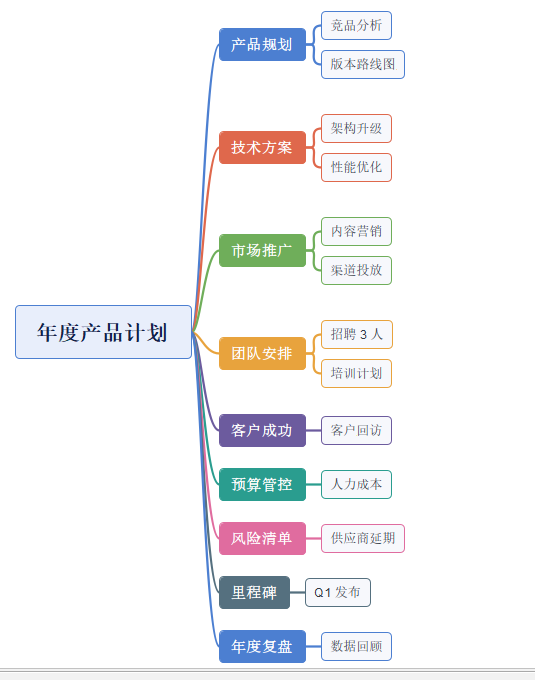
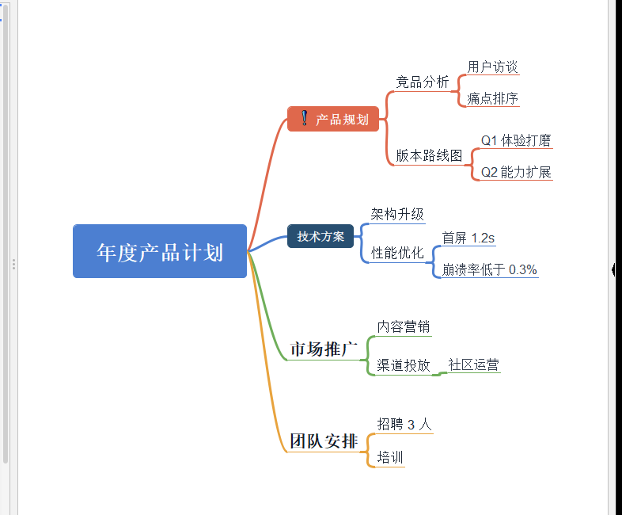
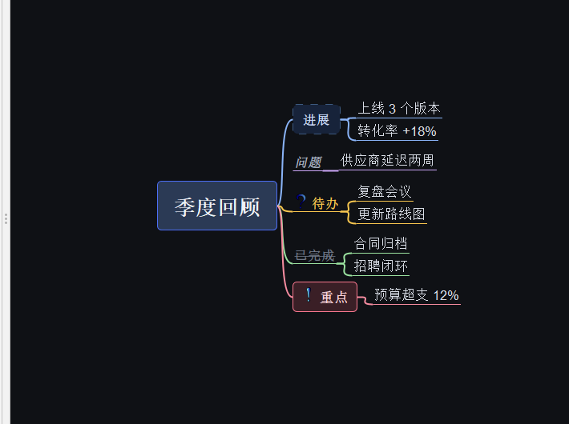
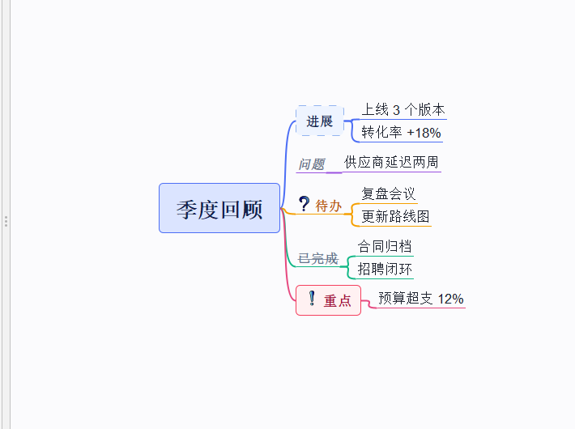

# Themes for Freeplane

[中文](README.md) · English

[](https://github.com/brick9527/freeplane-themes/actions/workflows/release.yml)
[](https://github.com/brick9527/freeplane-themes/releases/latest)
[](LICENSE-CC-BY-4.0.txt)

A small collection of mind-map themes (style templates) for [Freeplane](https://www.freeplane.org),
plus the bits needed to build and check your own.

A Freeplane theme is just an ordinary `.mm` map file — all the styling lives inside it, so no
code and no build step is involved. This repo ships a few ready-to-use themes, a structural
validator, and the gotchas collected while writing them.



## Download

No need to clone — grab a package from [Releases](https://github.com/brick9527/freeplane-themes/releases/latest):

| Take this | Use it for |
| --- | --- |
| a single `*.mm` | you only want one theme; drop it into `templates\` |
| `lucide-icons-<version>.addon.mm` | Lucide icon pack (2029 icons); installs a `lucide` group into the icon panel |
| `freeplane-themes-<version>-themes.zip` | all themes plus `NOTICE.txt` and the licences, flat layout — extract and the `.mm` files land in `templates\` |
| `freeplane-themes-<version>-full.zip` | the whole project: themes / demos / previews / docs / tools / licences |
| `freeplane-themes-<version>-source.zip`, `-source.tar.gz` | source snapshot of that tag (CI config included) |
| `SHA256SUMS.txt` | SHA-256 of every file above; verify with `sha256sum -c SHA256SUMS.txt` |

Every package carries the full licence texts and the attribution notice: themes, demo maps,
screenshots and docs are **CC BY 4.0**, the scripts are **GPL-2.0**.

## Install

**1. As a template** (recommended)

```
Tools → Open user directory
  └─ templates\              ← create it if missing, drop the .mm in
File → New map from template…
  └─ pick “User templates (*.mm)” in the file type dropdown
```

On Windows the installer's user directory is `%APPDATA%\Freeplane\<version>\templates`;
portable installs use `%USERPROFILE%\.freeplane\<version>\templates`. When in doubt, use the menu.

Or run the helper (Windows, finds the user directory itself):

```powershell
.\tools\install_themes.ps1
```

To make a theme the default for new maps: `Tools → Preferences → Environment → Standard template file`.

**2. Apply to an existing map**

```
Format → Manage Styles → Copy map styles from…      (merge styles)
Format → Manage Styles → Replace map styles by…     (replace everything)
```

**3. Just look at it**: open any file in `demos/` — sample maps that already use the theme.

> ⚠️ `AutomaticEdgeColor` only assigns colours **when a branch is created**. Applying a theme to an
> existing map will not recolour the edges that are already there — create a new branch or set the
> branch colour manually.

## Themes

| File | Look | Notes |
| --- | --- | --- |
| [`themes/xmind-classic.mm`](themes/xmind-classic.mm) | XMind classic | dark central pill, coloured level-1 cards (8-card palette), branch-coloured outlines |
| [`themes/xmind-zen.mm`](themes/xmind-zen.mm) | XMind modern | white canvas, no borders, text + thick coloured curves |
| [`themes/ember-night.mm`](themes/ember-night.mm) | dark | dark canvas, per-level colours, semantic styles (Callout/Todo/Done/Quote) |
| [`themes/ember-day.mm`](themes/ember-day.mm) | light | same family as night |

| xmind-classic | xmind-zen |
| --- | --- |
|  |  |
| **ember-night** | **ember-day** |
|  |  |

All four are real Freeplane 1.13.4 window captures; the source files live in `demos/` — just open them.

### The 8-card palette (xmind-classic)

Level-1 topics default to “white card + 2 px branch-colour outline”. Applying `色卡1`…`色卡8`
(`card 1`…`card 8`) turns them into solid coloured cards:

| Style | Fill | Text | Contrast on white text |
| --- | --- | --- | --- |
| `色卡1 蓝` | `#4C7FD1` | `#FFFFFF` | 3.99 |
| `色卡2 朱` | `#DF684C` | `#FFFFFF` | 3.38 |
| `色卡3 绿` | `#6FAE5A` | `#FFFFFF` | 2.67 |
| `色卡4 橙` | `#E8A33D` | `#FFFFFF` | 2.16 |
| `色卡5 紫` | `#6C5B9E` | `#FFFFFF` | 5.79 |
| `色卡6 青` | `#2A9D8F` | `#FFFFFF` | 3.32 |
| `色卡7 粉` | `#E06C9F` | `#FFFFFF` | 3.08 |
| `色卡8 灰蓝` | `#55707F` | `#FFFFFF` | 5.24 |

Usage: select a level-1 topic → the “style” dropdown in the toolbar → pick a card.

**Order is the colour.** `AutomaticEdgeColor` hands out branch colours in the order of
`edgeColorConfiguration`, so branch 1 gets `#4C7FD1`, branch 2 `#DF684C`, and so on. Apply the cards
in the same order and every card matches the colour of its own edge. The palette has 8 colours, so
branch 9 falls back to the first colour (`色卡1`), branch 10 to the second, and so on.

15 pt bold counts as WCAG “large text” (threshold 3:1). `色卡4 橙` and `色卡3 绿` are below that and
white text looks a little washed out. To fix it, darken those fills by one step (same hue):
`#E8A33D → #BC7916`, `#6FAE5A → #5D974A`, `#DF684C → #DD6245`, `#2A9D8F → #28988B`, `#E06C9F → #DC5B93`.

## Icons

A theme cannot ship icons — a `.mm` only stores icon names. Beyond the set bundled with Freeplane
you can install this repo's **Lucide icon add-on**: 2029 SVGs filed under Lucide's 42 categories in
`<userdir>/icons/lucide/`.

```
File → Open map…            pick lucide-icons-<version>.addon.mm
Tools → Plugins → Add-on installer   → install → restart Freeplane
```

Then pick from the `lucide` group in the icon panel and reference it as
`BUILTIN="lucide/notifications/circle-check"`. How the user icon folder works, where the common
icons live, how to add your own and how to rebuild the pack:
**[docs/icons.md](docs/icons.md)** (Chinese, like the rest of `docs/`).

> Icons are local only: send a map that uses Lucide icons to someone without the add-on and the
> icons are missing there.

## Build your own

A theme is a `.mm` file whose `<hook NAME="MapStyle">` contains a `<map_styles>` tree. The full
attribute list, enum values and pitfalls are in **[docs/style-reference.md](docs/style-reference.md)**
(checked against the Freeplane sources and its bundled templates).

Check your work:

```powershell
python tools\validate_theme.py themes\xmind-classic.mm
```

It verifies the XML structure, the style tree, the three hooks, enum values and colour formats, plus
the two things that fail silently: `TEXT` vs `LOCALIZED_TEXT`, and `STYLE_REF` vs `LOCALIZED_STYLE_REF`.

Regenerate the demo maps:

```powershell
python tools\make_demo.py .
```

## Layout

```
themes/     theme templates (.mm)
demos/      sample maps (.mm) that already use a theme — just open them
previews/   real Freeplane screenshots (.png)
addons/     source of the icon add-on (lucide-icons: metadata + Lucide licence text)
tools/      validate_theme.py, make_demo.py, build_release.py, build_icon_addon.py, install_themes.ps1
docs/       style-reference.md (format reference), icons.md (icons), releasing.md (how releases work)
.github/    CI: validate.yml on every push, release.yml publishes on a tag
```

## Releasing

```bash
git tag -a v1.0.0 -m "v1.0.0"
git push origin v1.0.0
```

That is the whole procedure: CI validates every theme, checks that `demos/` still matches
`themes/`, packages one `.mm` per theme plus `lucide-icons-<version>.addon.mm`, `-themes.zip`,
`-full.zip`, `-source.zip` / `-source.tar.gz` and `SHA256SUMS.txt`, then creates the release with
generated notes.
Re-running a tag refreshes the assets instead of failing. Details (triggers, asset list,
rollback) are in [docs/releasing.md](docs/releasing.md).

## Known limitations

1. Freeplane cannot make a **node fill follow the branch colour** (only border colour / width / dash
   can follow the edge, via `BORDER_*_LIKE_EDGE`), so solid cards are applied by hand — that is the
   only extra step compared to XMind.
2. Edges are always the same width; there is no tapered line.
3. Themes cannot ship icons or stickers — only `BUILTIN` icon names; for more, install the
   [Lucide icon add-on](docs/icons.md) (user icons are local files, so people without it see nothing).
4. Themes only affect the mind map rendering, not the editor UI (that is the FlatLaf `.theme.json` layer).

## Compatibility

The `.mm` files use the `freeplane 1.9.8` format; Freeplane 1.11 / 1.12 / 1.13 all read them.
Older versions are untested.

## License

Code and content are licensed separately:

| Content | License | Text |
| --- | --- | --- |
| `tools/`, `.github/` | GPL-2.0 (SPDX: `GPL-2.0-only`) | [LICENSE](LICENSE) |
| `themes/`, `demos/`, `previews/`, `docs/` | **CC BY 4.0** (or GPL-2.0, your choice) | [LICENSE-CC-BY-4.0.txt](LICENSE-CC-BY-4.0.txt) |
| `addons/lucide-icons/` (the icons themselves) | **ISC** (Feather-derived icons: MIT), © Lucide | [LICENSE-lucide.txt](addons/lucide-icons/LICENSE-lucide.txt) |

**Why split it**: a theme is a data file, not a program. Putting GPL on data files makes people worry
that their own maps become GPL, and GPL was not designed for that kind of content. So the themes, demo
maps, screenshots and docs are **CC BY 4.0** — attribution is all it takes; commercial use, recolouring
and shipping inside a closed-source template are all fine. If you prefer GPL, the same files may also be
used under GPL-2.0.

The code (validator, demo generator, CI) stays GPL-2.0, matching the Freeplane repository, so a pull
request upstream needs no relicensing.

**The only hard requirement of CC BY 4.0 is attribution**: keep a link back to this repository and
`Copyright (c) 2026 brick9527`, and indicate whether changes were made.

Applying a theme to your own map does not change the license of that map — it is your content.

The palette is inspired by XMind's default themes (colour values are not copyrightable); the structure
and attribute names come from Freeplane's open-source implementation.
