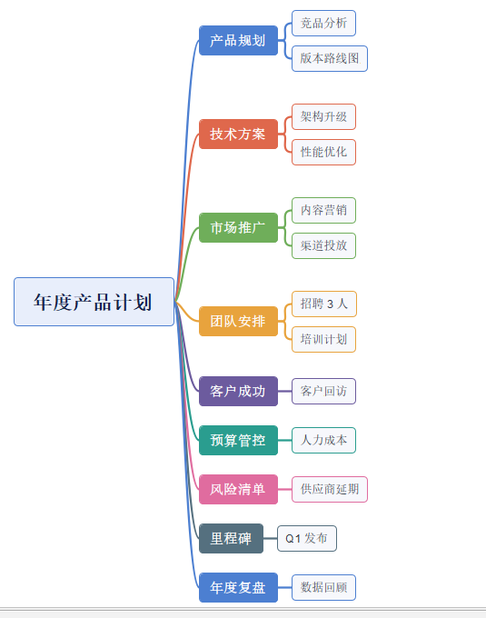
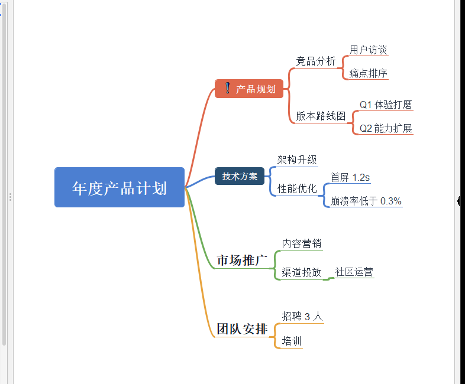
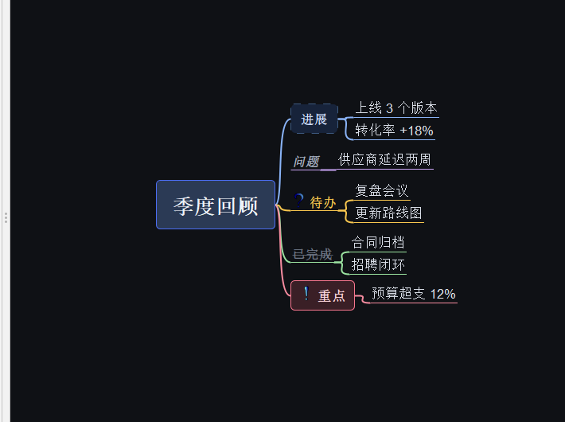
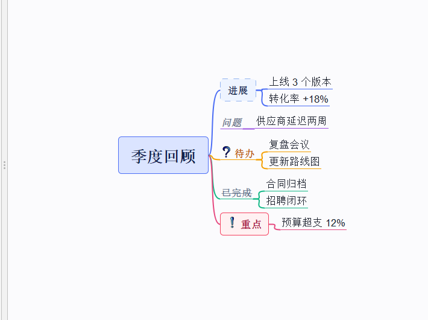

# Freeplane 脑图主题

中文 · [English](README.en.md)

A small collection of mind-map themes (style templates) for [Freeplane](https://www.freeplane.org),
plus the bits needed to build and check your own.

Freeplane 的主题就是一个普通的 `.mm` 模板文件 —— 样式全在里面，不需要写代码、不需要编译。
这个仓库提供几套可直接用的主题、一个结构校验脚本，以及踩坑记录。



## 安装 / 加载

**1. 装成模板**（推荐）

```
工具 → 打开用户目录            (Tools → Open user directory)
  └─ templates\              ← 没有就新建，把 .mm 放进去
文件 → 从模板新建导图…        (File → New map from template…)
  └─ 文件类型选「用户模板 (*.mm)」
```

Windows 安装版用户目录是 `%APPDATA%\Freeplane\<版本>\templates`，
免安装版是 `%USERPROFILE%\.freeplane\<版本>\templates`。记不住就用菜单打开。

也可以一条命令（自动定位用户目录，Windows）：

```powershell
.\tools\install_themes.ps1
```

想让某套主题成为默认：`工具 → 首选项 → 环境 → 默认模板文件`。

**2. 套到已有的图上**

```
格式 → 管理样式 → 从…中复制导图样式…   (Copy map styles from…)
格式 → 管理样式 → 替换导图样式为…       (Replace map styles by…)
```

**3. 只看效果**：双击 `demos/*.mm`，就是带示例内容的演示图。

> ⚠️ `AutomaticEdgeColor` 只在**新建分支**时上色。用方式 2 套主题时，已有连线不会自动变色，
> 需要新建一个分支或手动给分支设色。

## 主题

| 文件 | 风格 | 说明 |
| --- | --- | --- |
| [`themes/xmind-classic.mm`](themes/xmind-classic.mm) | XMind 经典 | 中央深色胶囊 + 一级彩色卡片（8 色卡）+ 分支色描边 |
| [`themes/xmind-zen.mm`](themes/xmind-zen.mm) | XMind 现代 | 纯白底、无边框，文字 + 粗彩色曲线 |
| [`themes/ember-night.mm`](themes/ember-night.mm) | 深色 | 深底 + 层级配色 + 语义样式（Callout/Todo/Done/Quote） |
| [`themes/ember-day.mm`](themes/ember-day.mm) | 浅色 | 与 night 同色系 |

| xmind-classic | xmind-zen |
| --- | --- |
|  |  |
| **ember-night** | **ember-day** |
|  |  |

四张都是 Freeplane 1.13.4 实际渲染的窗口截图，对应的源文件在 `demos/` 下，双击即可打开。

### 8 个顺序色卡（xmind-classic）

一级主题默认是「白底 + 2 px 分支色描边」。套上 `色卡1`…`色卡8` 就变成实心彩卡：

| 样式名 | 底色 | 文字 | 白字对比度 |
| --- | --- | --- | --- |
| `色卡1 蓝` | `#4C7FD1` | `#FFFFFF` | 3.99 |
| `色卡2 朱` | `#DF684C` | `#FFFFFF` | 3.38 |
| `色卡3 绿` | `#6FAE5A` | `#FFFFFF` | 2.67 |
| `色卡4 橙` | `#E8A33D` | `#FFFFFF` | 2.16 |
| `色卡5 紫` | `#6C5B9E` | `#FFFFFF` | 5.79 |
| `色卡6 青` | `#2A9D8F` | `#FFFFFF` | 3.32 |
| `色卡7 粉` | `#E06C9F` | `#FFFFFF` | 3.08 |
| `色卡8 灰蓝` | `#55707F` | `#FFFFFF` | 5.24 |

用法：选中一级主题 → 工具栏「样式」下拉 → 选 `色卡N`。

**顺序即颜色**：`AutomaticEdgeColor` 按 `edgeColorConfiguration` 的顺序给新分支上色，
第 1 支拿 `#4C7FD1`、第 2 支 `#DF684C`…… 所以按顺序套色卡，卡片底色和它的连线永远同色。
调色板只有 8 色，第 9 个分支回到第 1 色（`色卡1`），第 10 个 `色卡2`，以此类推。

15pt 粗体属于 WCAG 的「大字号」（门槛 3:1），`色卡4 橙` 和 `色卡3 绿` 低于门槛，白字会略糊。
想达标就把底色压暗一档（同色相）：
`#E8A33D → #BC7916`、`#6FAE5A → #5D974A`、`#DF684C → #DD6245`、`#2A9D8F → #28988B`、`#E06C9F → #DC5B93`。

## 自己做一个

主题 = 一张 `.mm`，里面 `<hook NAME="MapStyle">` 下有 `<map_styles>` 样式树。
完整的属性、枚举值、易错点见 **[docs/style-reference.md](docs/style-reference.md)**（从 Freeplane
源码和官方模板里核对出来的）。

改完用脚本自检：

```powershell
python tools\validate_theme.py themes\xmind-classic.mm
```

它会检查 XML 结构、样式树是否完整、三个 hook 是否齐全、枚举值与颜色格式，
以及最容易静默失效的两处：`TEXT`/`LOCALIZED_TEXT` 与 `STYLE_REF`/`LOCALIZED_STYLE_REF` 的配对。

重新生成演示图：

```powershell
python tools\make_demo.py .
```

## 目录

```
themes/     主题模板（.mm）
demos/      带示例内容的演示图（.mm），双击即可看效果
previews/   演示图的 Freeplane 真实截图（.png）
tools/      validate_theme.py 校验 / make_demo.py 生成演示 / install_themes.ps1 安装
docs/       style-reference.md 格式速查
```

## 已知限制

1. Freeplane 的**节点填充色不能跟随分支色**（只有边框的颜色/宽度/线型能跟随 `BORDER_*_LIKE_EDGE`），
   所以实心彩卡需要手动套样式 —— 这是比 XMind 多出来的唯一一步。
2. 连线只有等宽曲线，没有 XMind 那种锥形渐细（tapered line）。
3. 主题不携带图标/贴纸，只能用内置 `BUILTIN` 图标名。
4. 主题只影响 mind map 渲染，不影响编辑器 UI（那是 FlatLaf `.theme.json` 那层）。

## 兼容性

`.mm` 用的是 `freeplane 1.9.8` 格式，Freeplane 1.11 / 1.12 / 1.13 都能读。
更老的版本未测试。

## License

代码和内容分开授权：

| 内容 | 许可 | 全文 |
| --- | --- | --- |
| `tools/`、`.github/` | GPL-2.0（SPDX：`GPL-2.0-only`） | [LICENSE](LICENSE) |
| `themes/`、`demos/`、`previews/`、`docs/` | **CC BY 4.0**（也可按 GPL-2.0 使用，二选一） | [LICENSE-CC-BY-4.0.txt](LICENSE-CC-BY-4.0.txt) |

**为什么这样分**：主题是数据文件，不是程序。用 GPL 授权数据文件，会让不少人担心"套了主题我的导图是不是也被
传染了"，而 GPL 本来也不是为这类内容设计的。所以主题、示例图、截图、文档默认走 **CC BY 4.0** —— 署名即可使用，
商用、改色、放进闭源模板都没问题；如果你更习惯 GPL，同一份文件也可以选择按 GPL-2.0 使用。

代码（校验脚本、演示图生成脚本、CI）保持 GPL-2.0，和 Freeplane 主仓库一致，方便回提 PR。

**CC BY 4.0 的唯一硬性要求是署名**：再分发时请保留出处（本仓库链接）和
`Copyright (c) 2026 brick9527`，并注明是否做过修改。

把主题套到你自己的导图上，不会改变导图内容的授权 —— 那是你的作品。

配色参考了 XMind 的默认主题（色值本身不构成版权内容），结构和属性名来自 Freeplane 的开源实现。
